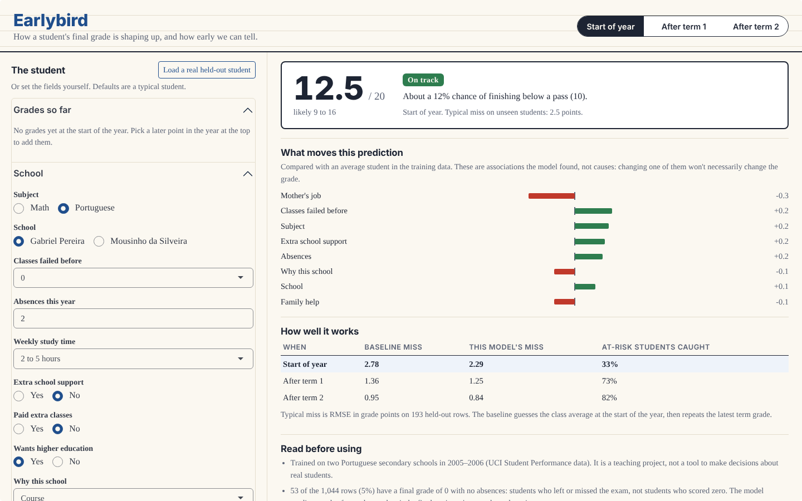

# Earlybird

How early can you tell that a student is heading for a failing grade? Earlybird
predicts a secondary-school student's final grade (0 to 20, pass at 10) at three
points in the year: before any grades exist, after the first term, and after the
second. It's built in R with tidymodels and ships as a Shiny app that shows the
prediction, the chance of failing, and which answers moved it.

**[Live demo](https://evannwilsonn.github.io/earlybird/)** (runs entirely in your browser through Shinylive; the first load takes a few seconds)



The short version of what I found:

| When | Baseline miss | Earlybird's miss | At-risk students caught |
| --- | --- | --- | --- |
| Start of year | 2.78 | 2.29 | 33% |
| After term 1 | 1.36 | 1.25 | 73% |
| After term 2 | 0.95 | 0.84 | 82% |

*Miss is RMSE in grade points on 128 held-out students (193 rows) the models never
saw. "Caught" is the share of students who actually finished below 10 that the app's
model flagged.*

Background alone (family, study habits, past failures, absences) explains about 30%
of the variation in final grades. That's useful, but it misses two out of three
students who go on to fail. One term of real grades changes everything. So the honest
pitch for an early-warning system built on this data is "wait for the first grade,"
not "predict from day one."

Two more findings:

- **Leaving out sex, age, home address, parents' marital status and dating status
  costs nothing.** Cross-validated error moved from 2.536 to 2.528 at the start of
  the year (lower, within noise), and the app ships the version without them.
- **The fancy models barely beat a regularised linear model.** Random forests and
  boosted trees win by about one standard error at most. The app uses the linear
  model because its prediction can be explained term by term.

## Run it

```sh
# R 4.3+; packages: tidymodels, glmnet, ranger, xgboost, shiny, bslib, jsonlite, testthat
Rscript analysis/run.R                       # the whole loop, ~15 minutes; writes results/ and app/model.rds
Rscript -e 'testthat::test_dir("tests/testthat")'
Rscript -e 'shiny::runApp("app")'            # the app
Rscript -e 'shinylive::export("app", "docs")'  # the static browser build GitHub Pages serves
```

## The loop

The project follows the seven-step loop from the @livmanish AI/ML roadmap:
Problem → Data → Baseline → Model → Evaluation → Improvement → Deployment.

### 1. Problem

Predict the final grade G3 for one student in one subject. The useful question
isn't "what will they get" but "will they fail, and how soon can we see it", so the
same problem is solved three times with the information a teacher has at each
point:

| Moment | Features |
| --- | --- |
| Start of year | 31 background answers, 26 without the sensitive ones (no grades) |
| After term 1 | the same, plus the first period grade G1 |
| After term 2 | the same, plus G1 and G2 |

`features_for()` in `R/data.R` builds these lists, and a test checks that no moment
ever sees a later grade.

### 2. Data

The [UCI Student Performance](https://archive.ics.uci.edu/dataset/320/student+performance)
dataset: students at two Portuguese secondary schools in 2005–06, with 30 survey
and school-record attributes and three period grades. One file per subject, math
(395 rows) and Portuguese (649 rows), combined here with a `subject` column.

Two things in the data needed care before modelling:

- **Many students are in both files.** There's no student id, so I matched rows
  the way the dataset's own merge script does, on 13 background columns. That
  gives 662 distinct students, 366 of them taking both subjects (the authors
  report 382; a handful of key collisions put two real students under one id,
  which only makes the split more conservative). The train/test split and every
  cross-validation fold are grouped by student, so nobody's Portuguese grade helps
  predict their own math grade.
- **A final grade of 0 doesn't mean they scored 0.** All 53 zeros (5% of rows)
  come with zero absences, and 33 of them had a non-zero second-term grade. These
  are students who left or missed the exam. Training a grade model on them teaches it that some
  good students randomly score 0, so they're excluded from the regression and
  reported separately. The app says plainly that it can't warn about dropping out.

The split holds out 20% of students (128) for a single final test. Everything else
uses 10-fold cross-validation grouped by student on the remaining 519.

### 3. Baseline

At the start of the year: predict the training average for everyone (CV RMSE 2.94).
Once a period grade exists: carry the latest grade forward unchanged, so G3 = G1
(1.57) or G3 = G2 (0.99). The carry-forward baseline is strong, which is the point:
a model that can't beat "same as last term" isn't worth having.

### 4. Model

All models share one tidymodels recipe: dummy-code the categories, drop
zero-variance columns, centre and scale.

- **OLS by hand** (`R/ols.R`). The normal equations X'Xb = X'y solved through a QR
  decomposition rather than by inverting X'X, which squares the condition number
  (G1 and G2 correlate at 0.9). Collinear columns are dropped the way `lm()` drops
  them. On the full training set its coefficients match `lm()` to 2.1 × 10⁻¹⁴,
  and it gives the identical cross-validated error.
- **Elastic net** (glmnet), tuning the penalty and the lasso/ridge mix.
- **Random forest** (ranger) and **boosted trees** (xgboost), each tuned on a grid.

### 5. Evaluation

Cross-validated RMSE in grade points (± one standard error across folds):

| Model | Start of year | After term 1 | After term 2 |
| --- | --- | --- | --- |
| Baseline | 2.94 ± 0.08 | 1.57 ± 0.05 | 0.99 ± 0.06 |
| OLS (by hand) | 2.56 ± 0.07 | 1.42 ± 0.05 | 0.92 ± 0.06 |
| Linear (`lm`) | 2.56 ± 0.07 | 1.42 ± 0.05 | 0.92 ± 0.06 |
| Elastic net | 2.54 ± 0.07 | 1.40 ± 0.05 | 0.91 ± 0.06 |
| Random forest | **2.45** ± 0.08 | 1.40 ± 0.03 | 0.92 ± 0.06 |
| Boosted trees | 2.47 ± 0.08 | **1.34** ± 0.04 | 0.92 ± 0.06 |

The held-out test set was used once, at the end, for every configuration
(`results/test.csv`). On it the elastic net the app ships scores 2.29, 1.25 and
0.84, against 2.78, 1.36 and 0.95 for the baselines.

RMSE isn't the whole story for an early-warning tool, so the test also scores the
pass/fail call (flag a student when the predicted grade is under 10). At the start of
the year the model catches a third of the students who end up failing, and about
half of its flags are right. After term 1 it catches 73%, after term 2 82%. Worth
saying plainly: once a grade exists, "same as last term" flags failing students about
as well (76% and 82%). The model's gain there is a tighter grade estimate, not more
students caught.

### 6. Improvement

Two things were tried on the elastic net, and both were scored by cross-validation
before the test set was touched:

- **Feature engineering**: total alcohol (weekday + weekend), the higher of the two
  parents' education levels, log of absences, and "has failed before". Gain:
  2.536 → 2.518 at the start of the year, under one standard error. Honest
  verdict: the model already had the information.
- **Removing sensitive attributes** (sex, age, urban/rural address, parents
  together or apart, in a relationship): 2.536 → 2.528. No loss at any moment.
  This is the change that shipped, because it's the one a school would care about.

### 7. Deployment

`app/` is a Shiny app with three parts:

- **The prediction**: the expected final grade with a likely range (±1.28 CV RMSE,
  roughly an 80% band), and the chance of finishing below 10 under a normal error
  model.
- **What moved it**: each answer's contribution compared with an average student,
  read straight off the linear model (contributions plus the intercept add up to the
  prediction exactly). The page says these are associations, not causes.
- **Load a real held-out student**: fills the form with a student the model never
  saw and shows the grade they actually got, so you can watch it be right and wrong.

To run without a server, the fitted workflow is exported to plain numbers (category
levels, centring and scaling, coefficients) and predicted with ~40 lines of base R
in `app/predict.R`. `analysis/run.R` checks the export against the tidymodels
workflow on every test row (they agree to 10⁻¹⁴) and refuses to save it otherwise.
That lets Shinylive run the whole app in the browser with only shiny and bslib.

## What I'd be careful about

- The data is two schools in one country in 2005–06. Grading scales, what counts as
  a support programme and who drinks how much won't transfer.
- The survey answers are self-reported.
- A start-of-year prediction that misses two in three failing students shouldn't
  be used to label anyone. Its real use is showing how much the first term's grade
  is worth.

## Layout

```
R/data.R           load both subjects, match students, missed finals, feature lists, grouped split
R/ols.R            OLS by hand (QR solve of the normal equations)
R/export.R         engineered features; workflow -> plain numbers for the app
analysis/run.R     the whole loop: baselines, CV, tuning, test, checks, export
app/app.R          Shiny app (shiny + bslib only)
app/predict.R      prediction and per-answer contributions in base R
app/model.rds      exported models, written by analysis/run.R
app/heldout.csv    the held-out students, for "load a real student"
results/           cv.csv, test.csv, metrics.json
tests/testthat/    data, split, leakage, OLS vs lm, export arithmetic
```

## Credits

Data: P. Cortez and A. Silva, "Using Data Mining to Predict Secondary School Student
Performance", Proceedings of FUBUTEC 2008, via the UCI Machine Learning Repository,
CC BY 4.0. See `data/README.md`.

The project choice and the seven-step loop come from the @livmanish AI/ML roadmap.
All code is original. MIT licence (code only).
